# EchoTwin AI
## The Intelligent Multiphase Subsea Pipeline Digital Twin

**A Unified Engineering Platform for Multiphase Flow Simulation, Pipeline Integrity, Flow Assurance, Sensor Fusion, and AI-Assisted Subsea Operations**

<p align="center">

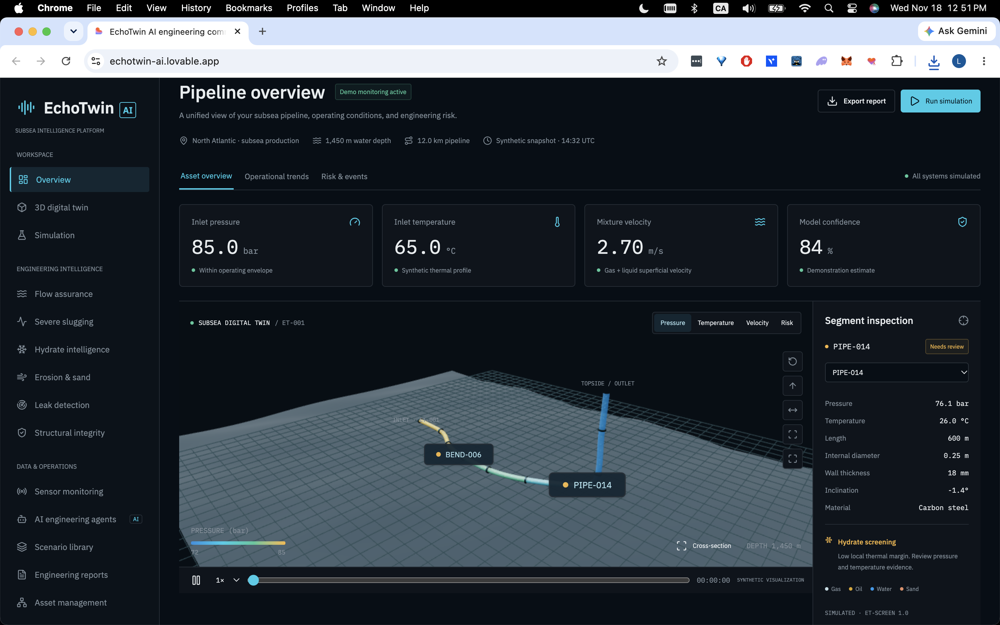

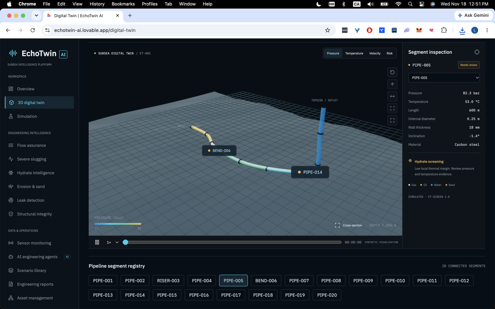

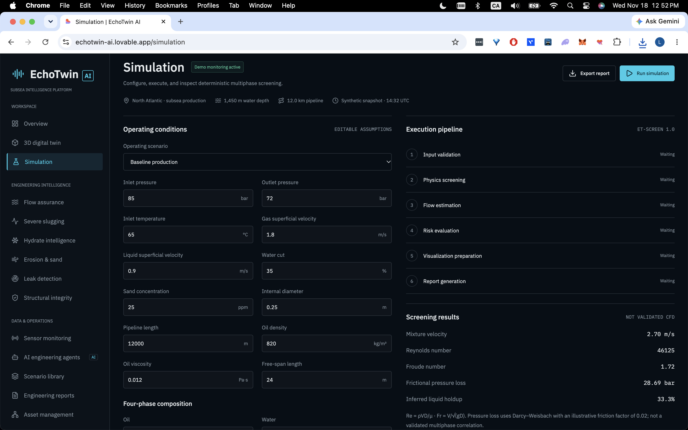

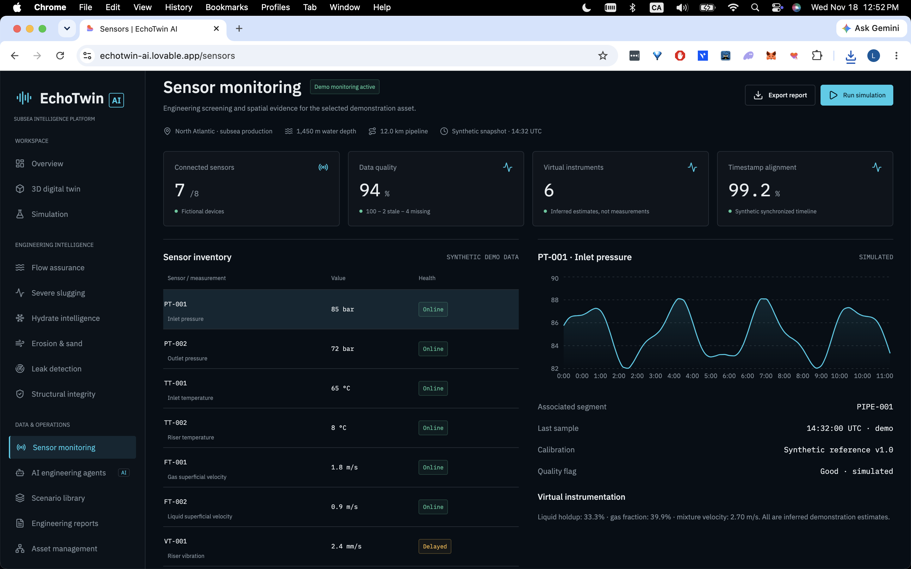

**One Pipeline. One Digital Twin. A Complete Engineering Picture.**

</p>

<p align="center">


</p>

---

# Table of Contents

1. [Project Overview](#1-project-overview)
2. [The Engineering Problem](#2-the-engineering-problem)
3. [Product Vision and Objectives](#3-product-vision-and-objectives)
4. [System Architecture](#4-system-architecture)
5. [Digital Twin Data Model](#5-digital-twin-data-model)
6. [Multiphase Flow Physics](#6-multiphase-flow-physics)
7. [Navier–Stokes and Simulation Architecture](#7-navier-stokes-and-simulation-architecture)
8. [Sensor Fusion and Virtual Instrumentation](#8-sensor-fusion-and-virtual-instrumentation)
9. [Flow Assurance Intelligence](#9-flow-assurance-intelligence)
10. [Hydrate Formation and Deposition](#10-hydrate-formation-and-deposition)
11. [Sand Transport and Erosion](#11-sand-transport-and-erosion)
12. [Leak Detection and Localization](#12-leak-detection-and-localization)
13. [Structural Integrity and Pipeline Health](#13-structural-integrity-and-pipeline-health)
14. [AI Engineering Agent Architecture](#14-ai-engineering-agent-architecture)
15. [Scientific Verification and Validation](#15-scientific-verification-and-validation)
16. [3D Visualization and Engineering Interface](#16-3d-visualization-and-engineering-interface)
17. [Backend, APIs, and Data Infrastructure](#17-backend-apis-and-data-infrastructure)
18. [Demo Data, Scenarios, and Reproducibility](#18-demo-data-scenarios-and-reproducibility)
19. [Installation, Testing, and Deployment](#19-installation-testing-and-deployment)
20. [Roadmap, Research Opportunities, and Conclusion](#20-roadmap-research-opportunities-and-conclusion)

---

# 1. Project Overview

## 1.1 What is EchoTwin AI?

EchoTwin AI is an intelligent subsea engineering platform designed to create a unified digital representation of a multiphase pipeline system.

It brings together:

- Multiphase fluid-flow modeling.
- Navier–Stokes-based simulation architecture.
- Pipeline asset visualization.
- Sensor fusion and virtual instrumentation.
- Transient pressure and temperature analysis.
- Severe slugging detection.
- Hydrate formation and deposition screening.
- Sand transport and erosion assessment.
- Leak detection and localization.
- Structural integrity monitoring.
- Predictive engineering workflows.
- Specialized AI engineering agents.
- Scientific verification and validation.
- Spatially localized engineering risk visualization.

Traditional engineering workflows frequently distribute these capabilities across different tools, datasets, models, and teams.

EchoTwin is designed around a shared pipeline state.

Instead of treating pressure, temperature, fluid composition, structural condition, and operational history as disconnected datasets, the platform connects them to the same physical asset and spatial coordinate system.

The result is a unified engineering environment where an engineer can select a pipeline location, inspect its measurements, investigate a transient event, evaluate potential flow-assurance problems, and review the associated structural implications.

## 1.2 Core concept

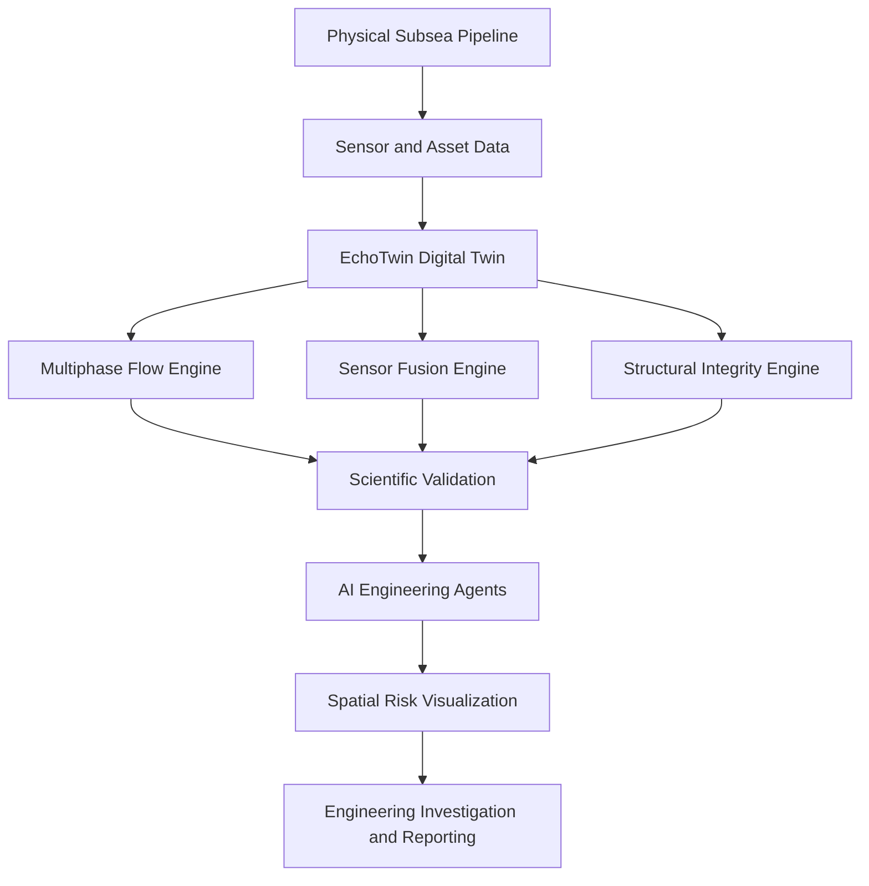

## 1.3 Product positioning

EchoTwin is positioned as a unified engineering decision-support environment rather than simply a 3D pipeline viewer or a standalone AI chatbot.

Its distinguishing feature is the connection between:

1. The physical pipeline.
2. Its geometric representation.
3. Operational measurements.
4. Multiphase flow behavior.
5. Simulation outputs.
6. Localized risk indicators.
7. Structural condition.
8. Engineering evidence and recommendations.

## 1.4 Primary engineering question

**Can a spatially synchronized, agent-assisted multiphysics digital twin combine operational measurements, transient multiphase simulation, flow-assurance screening, and structural-health information to produce traceable subsea pipeline assessments?**

EchoTwin provides a software architecture for exploring this question.

## 1.5 Project capabilities

| Capability | Description |
|---|---|
| Asset digital twin | Shared representation of pipeline assets and segments |
| Multiphase flow | Oil, gas, water, and transported solids |
| Transient simulation | Time-dependent pipeline-state calculations |
| Sensor fusion | Measurement quality and combined state estimation |
| Soft sensors | Estimation of quantities that are not directly measured |
| Flow assurance | Slugging, hydrate, and operating-condition screening |
| Erosion assessment | Sand transport and erosion-risk indicators |
| Leak analysis | Anomaly detection and potential leak localization |
| Structural integrity | Condition indicators and engineering review |
| AI agents | Specialized engineering analysis workflows |
| Scientific validation | Independent checks and traceable model evidence |
| 3D visualization | Spatially localized pipeline-state visualization |

## 1.6 Important engineering distinction

EchoTwin is an engineering software platform and research-oriented reference implementation.

A working interface, synthetic dataset, deterministic screening model, or AI-generated interpretation must not be mistaken for:

- A validated commercial multiphase simulator.
- A certified subsea engineering calculation package.
- A live connection to offshore infrastructure.
- A qualified leak-detection safety system.
- A substitute for a competent engineering assessment.

Production deployment requires validated physical models, verified numerical implementations, qualified datasets, and appropriate engineering approvals.

---

# 2. The Engineering Problem

## 2.1 Why subsea multiphase pipelines are difficult

Subsea production pipelines transport mixtures that can include:

- Oil.
- Natural gas.
- Produced water.
- Sand and other transported solids.

The behavior of these components changes with pressure, temperature, composition, geometry, inclination, flow rate, and operating conditions.

A pipeline is therefore not adequately described by a single flow-rate measurement.

Its condition evolves over space and time.

A change in operating conditions can affect:

- Pressure distribution.
- Temperature distribution.
- Gas and liquid phase fractions.
- Liquid accumulation.
- Flow regime.
- Pressure drop.
- Hydrate stability.
- Sand transport.
- Local wall loading.
- Structural loading.

These effects can interact.

For example, a change in gas and liquid flow can influence slugging behavior. Slugging can produce pressure fluctuations and changing local loads. These conditions may warrant further investigation of specific pipeline regions.

## 2.2 The fragmented engineering workflow

A conventional fragmented workflow may look like this:

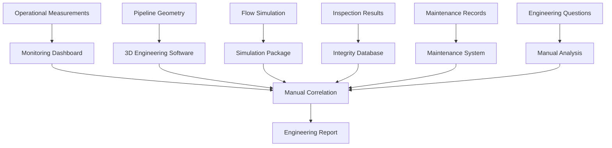

The challenge is not simply that these systems are separate.

The challenge is that their information must be reconciled.

For example:

- Does a pressure anomaly correspond to a particular pipeline segment?
- Which temperature measurements were available at that time?
- Was the pipeline operating under a different flow regime?
- Did the simulation use the same boundary conditions?
- Is the apparent anomaly supported by multiple sensors?
- Does the location correspond to a bend, riser, or restriction?
- Is the conclusion based on measured data, a numerical model, or an AI estimate?

EchoTwin addresses these questions through a common asset and spatial model.

## 2.3 Engineering objectives

The platform is designed to support five major objectives.

**Objective A — Understand the pipeline state**

Provide a unified representation of geometry, measurements, operating conditions, and historical events.

**Objective B — Investigate multiphase behavior**

Connect pipeline-wide transient calculations with localized flow investigations.

**Objective C — Identify flow-assurance concerns**

Screen for conditions associated with slugging, hydrate formation, deposition, and solids transport.

**Objective D — Connect flow behavior to pipeline integrity**

Make structural and operational information available in the same spatial context.

**Objective E — Make engineering conclusions traceable**

Preserve input data, model versions, assumptions, uncertainty, and validation evidence.

---

# 3. Product Vision and Objectives

## 3.1 One synchronized pipeline model

The fundamental EchoTwin design principle is that every engineering subsystem should reference the same asset identity and spatial coordinates.

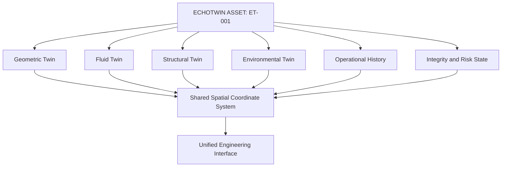

### Geometric twin

Represents:

- Pipeline route.
- Pipeline length.
- Internal diameter.
- Wall thickness.
- Bends and elbows.
- Risers.
- Manifolds.
- Segment boundaries.
- Spatial coordinates.

### Fluid twin

Represents:

- Pressure.
- Temperature.
- Flow rate.
- Phase fractions.
- Velocity.
- Liquid holdup.
- Flow regime.
- Fluid composition.

### Structural twin

Represents the engineering information needed to assess:

- Stress.
- Strain.
- Deformation.
- Fatigue.
- Wall condition.
- Structural loading.
- Potential damage.

### Environmental twin

Represents relevant external conditions:

- Seabed profile.
- Water depth.
- External temperature.
- Environmental loading.
- Pipeline exposure.
- Surrounding conditions.

### Operational history

Connects the current state with:

- Previous operating conditions.
- Shutdown events.
- Restart events.
- Historical anomalies.
- Inspection records.
- Maintenance activities.

## 3.2 Product workflow

The primary user workflow is:

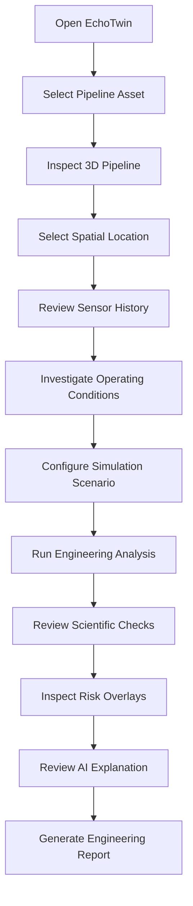

## 3.3 Intended users

| User | Primary use |
|---|---|
| Flow assurance engineer | Investigate multiphase behavior and operating conditions |
| Production engineer | Review operating states and production scenarios |
| Pipeline engineer | Inspect geometry and pipeline condition |
| Integrity engineer | Review localized structural and integrity indicators |
| Simulation engineer | Configure and compare numerical scenarios |
| Data scientist | Evaluate sensor fusion and predictive models |
| Engineering manager | Review risks, investigations, and reports |
| Researcher | Explore hybrid simulation and digital-twin methods |

---

# 4. System Architecture

## 4.1 High-level architecture

EchoTwin is organized into six principal engineering subsystems:

1. Asset Digital Twin.
2. Multiphase Flow Simulation.
3. Sensor Fusion and Virtual Instrumentation.
4. Flow Assurance and Integrity.
5. AI Engineering Orchestration.
6. Scientific Verification and Validation.

These subsystems share a common data layer.

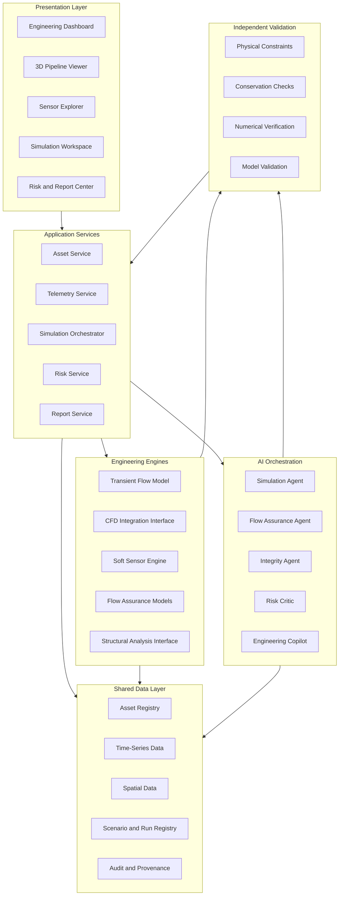

## 4.2 Architectural principles

**Shared state:** All subsystems reference a common asset and segment model.

**Separation of concerns:** Numerical models, AI agents, visualization, and validation are independent components.

**Traceability:** Every engineering result should reference its inputs and model version.

**Uncertainty awareness:** Estimates must be distinguishable from direct measurements.

**Reproducibility:** Scenario configurations should be stored so that a run can be reconstructed.

**Graceful degradation:** Missing or unreliable measurements should be identified rather than silently replaced with fabricated values.

**Independent validation:** AI agents must not be allowed to override scientific validation results.

## 4.3 Suggested repository structure

```text
echotwin-ai/
│
├── README.md
├── LICENSE
├── CONTRIBUTING.md
├── SECURITY.md
├── .env.example
├── docker-compose.yml
│
├── frontend/
│   ├── src/
│   │   ├── app/
│   │   ├── components/
│   │   │   ├── dashboard/
│   │   │   ├── pipeline/
│   │   │   ├── simulation/
│   │   │   ├── sensors/
│   │   │   ├── flow-assurance/
│   │   │   ├── integrity/
│   │   │   └── reports/
│   │   ├── features/
│   │   ├── hooks/
│   │   ├── services/
│   │   ├── stores/
│   │   ├── types/
│   │   └── utils/
│   └── package.json
│
├── backend/
│   ├── app/
│   │   ├── api/
│   │   ├── core/
│   │   ├── models/
│   │   ├── schemas/
│   │   ├── services/
│   │   ├── repositories/
│   │   └── main.py
│   └── requirements.txt
│
├── engines/
│   ├── multiphase/
│   ├── transient/
│   ├── flow_assurance/
│   ├── hydrate/
│   ├── erosion/
│   ├── leak_detection/
│   ├── structural/
│   └── validation/
│
├── agents/
│   ├── orchestrator/
│   ├── simulation_agent/
│   ├── sensor_fusion_agent/
│   ├── flow_assurance_agent/
│   ├── integrity_agent/
│   ├── risk_critic/
│   └── engineering_copilot/
│
├── data/
│   ├── mock/
│   ├── schemas/
│   ├── fixtures/
│   └── scenarios/
│
├── tests/
│   ├── unit/
│   ├── integration/
│   ├── physics/
│   ├── validation/
│   └── end_to_end/
│
├── docs/
│   ├── architecture/
│   ├── engineering/
│   ├── api/
│   └── research/
│
└── scripts/
    ├── seed_demo_data.py
    ├── validate_environment.py
    └── run_demo.py
```

The directory names describe the logical module boundaries. Adapt them to the actual repository layout if implementation files use different names.

---

# 5. Digital Twin Data Model

## 5.1 Asset-centered data architecture

Every digital-twin record should be associated with a stable asset identifier.

A simplified asset hierarchy:

```text
EchoTwin
│
└── Asset
    │
    ├── Pipeline
    │   ├── Segment
    │   │   ├── Geometry
    │   │   ├── Sensor References
    │   │   ├── Fluid State
    │   │   ├── Structural State
    │   │   └── Risk Indicators
    │   │
    │   ├── Bend
    │   ├── Riser
    │   └── Manifold
    │
    ├── Operational History
    ├── Simulation Runs
    ├── Inspection Records
    ├── Maintenance Records
    └── Engineering Reports
```

## 5.2 Core entities

| Entity | Purpose |
|---|---|
| Asset | Physical pipeline system |
| Segment | Spatially defined pipeline section |
| Sensor | Measurement device or data source |
| SensorReading | Timestamped measurement |
| VirtualSensor | Estimated engineering quantity |
| FluidProperty | Phase-specific properties |
| OperatingState | Pipeline operating condition |
| Scenario | Configured engineering investigation |
| SimulationRun | Executed calculation or screening run |
| SpatialField | Position-dependent model output |
| RiskAssessment | Localized risk result |
| AgentRun | AI workflow execution |
| ValidationResult | Independent validation evidence |
| MaintenanceEvent | Historical maintenance record |
| EngineeringReport | Generated investigation document |

## 5.3 Example asset object

```json
{
  "asset_id": "ET-001",
  "name": "North Atlantic Production Pipeline",
  "asset_type": "subsea_multiphase_pipeline",
  "status": "demo",
  "geometry": {
    "length_m": 20000,
    "nominal_inner_diameter_m": 0.25,
    "wall_thickness_m": 0.02,
    "segment_count": 10
  },
  "fluid_system": {
    "phases": [
      "oil",
      "gas",
      "water",
      "sand"
    ]
  },
  "metadata": {
    "dataset_type": "synthetic",
    "model_version": "demo-1.0"
  }
}
```

All numerical values in this example are illustrative. They do not describe an actual installed pipeline.

## 5.4 Example sensor reading

```json
{
  "reading_id": "READ-000001",
  "asset_id": "ET-001",
  "segment_id": "ET-001-SEG-003",
  "sensor_id": "PRESSURE-003",
  "timestamp": "2026-11-18T10:00:00Z",
  "measurement": {
    "quantity": "pressure",
    "value": 12500000,
    "unit": "Pa"
  },
  "quality": {
    "status": "valid",
    "confidence": 0.98
  },
  "provenance": {
    "source": "synthetic_demo_generator"
  }
}
```

## 5.5 Data integrity principles

The system should:

- Preserve measurement timestamps.
- Preserve original units.
- Record unit conversions.
- Store source and quality metadata.
- Distinguish measured and estimated values.
- Maintain stable asset and segment identifiers.
- Record the model version used for calculations.
- Preserve scenario configurations.
- Prevent a failed validation from being represented as a successful engineering result.

## 5.6 Example relational structure

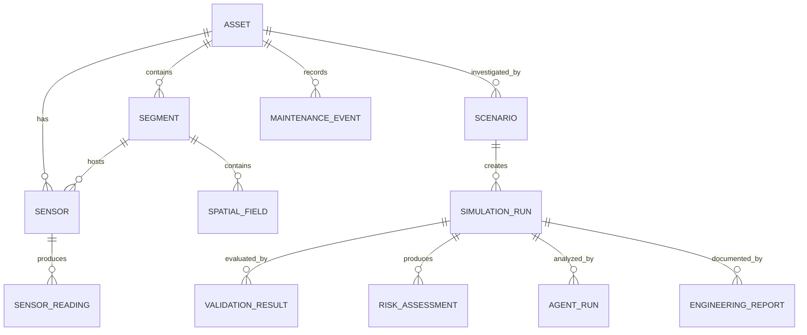

---

# 6. Multiphase Flow Physics

## 6.1 Four-component fluid system

EchoTwin models a production-flow environment containing four principal components:

| Component | Engineering relevance |
|---|---|
| Oil | Liquid hydrocarbon phase |
| Gas | Compressible hydrocarbon phase |
| Water | Produced aqueous phase |
| Sand | Transported solid particles |

The components do not behave identically.

Gas is compressible. Liquids are comparatively weakly compressible under many operating conditions. Sand introduces particle transport and possible wall interaction.

The local behavior depends on fluid properties, geometry, operating conditions, and interactions between phases.

## 6.2 Phase fractions

For a simplified volumetric representation:

\[
\alpha_o+\alpha_g+\alpha_w+\alpha_s=1
\]

where:

- \(\alpha_o\): oil volume fraction.
- \(\alpha_g\): gas volume fraction.
- \(\alpha_w\): water volume fraction.
- \(\alpha_s\): solids volume fraction.

A valid phase-fraction state must satisfy:

\[
0 \leq \alpha_k \leq 1
\]

for each phase \(k\).

The phase fractions must be consistent with the selected physical model and its definitions of volume averaging.

## 6.3 Conservation of mass

A general multiphase phase-continuity representation is:

\[
\frac{\partial(\alpha_k \rho_k)}{\partial t}
+
\nabla\cdot(\alpha_k\rho_k\mathbf{u}_k)
=
\Gamma_k
\]

where:

- \(\rho_k\) is phase density.
- \(\mathbf{u}_k\) is phase velocity.
- \(\Gamma_k\) represents interphase mass transfer.

For a model without interphase mass transfer:

\[
\Gamma_k=0
\]

The equation must be adapted to the selected multiphase formulation.

## 6.4 Momentum conservation

A general phase momentum equation can be represented as:

\[
\frac{\partial(\alpha_k\rho_k\mathbf{u}_k)}{\partial t}
+
\nabla\cdot
(\alpha_k\rho_k\mathbf{u}_k\mathbf{u}_k)
=
-\alpha_k\nabla p
+
\nabla\cdot(\alpha_k\boldsymbol{\tau}_k)
+
\alpha_k\rho_k\mathbf{g}
+
\mathbf{M}_k
\]

where:

- \(p\) is pressure.
- \(\boldsymbol{\tau}_k\) is the phase stress tensor.
- \(\mathbf{g}\) is gravitational acceleration.
- \(\mathbf{M}_k\) represents interphase momentum exchange.

This is a general modeling framework, not a claim that every term is implemented in every EchoTwin simulation mode.

## 6.5 Energy conservation

A representative energy balance is:

\[
\frac{\partial E}{\partial t}
+
\nabla\cdot[(E+p)\mathbf{u}]
=
\nabla\cdot(k\nabla T)
+
Q
+
S_E
\]

where:

- \(E\) is total energy density.
- \(k\) is thermal conductivity.
- \(T\) is temperature.
- \(Q\) represents heat sources or sinks.
- \(S_E\) represents model-specific energy contributions.

## 6.6 Flow regimes

Potential flow-regime classifications include:

- Stratified flow.
- Intermittent flow.
- Slug flow.
- Annular flow.
- Dispersed flow.

The applicable regime depends on geometry, inclination, fluid properties, and operating conditions.

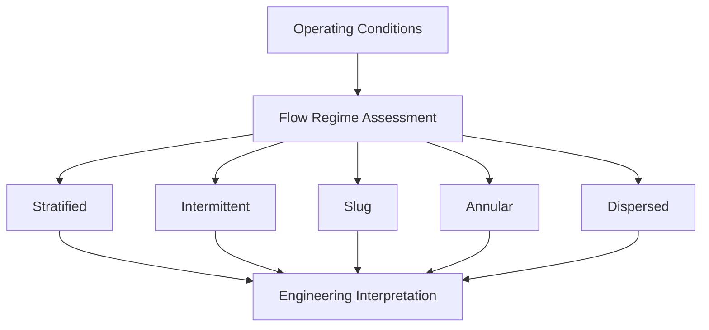

A regime classifier should expose its assumptions and applicability limits rather than presenting a universal classification independent of the underlying model.

## 6.7 Why this matters

The purpose of the multiphase engine is to create a physically meaningful state representation that other engineering subsystems can use.

It provides the foundation for:

- Pressure-drop investigation.
- Phase-holdup estimation.
- Transient behavior analysis.
- Slugging screening.
- Hydrate-condition assessment.
- Sand-transport analysis.
- Localized engineering investigations.

---

# 7. Navier–Stokes and Simulation Architecture

## 7.1 A multi-resolution simulation strategy

EchoTwin uses a multi-level simulation architecture.

One numerical model should not be expected to solve every problem at every spatial and temporal scale.

The architecture separates pipeline-wide calculations, detailed local CFD, and accelerated approximations.

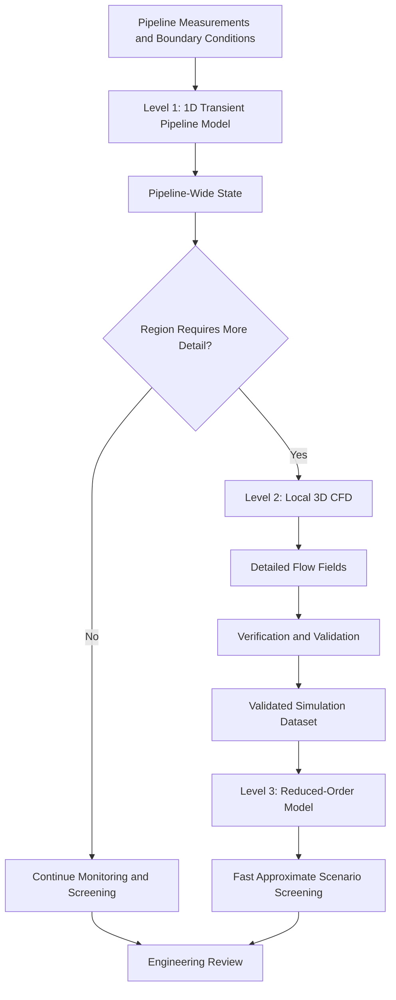

## 7.2 Level 1 — 1D transient pipeline model

The pipeline-wide model is intended for:

- Full-network investigations.
- Transient pressure behavior.
- Temperature evolution.
- Phase-holdup estimation.
- Flow-rate changes.
- Scenario comparisons.
- Initial anomaly screening.
- Identification of locations that may require more detailed analysis.

A one-dimensional representation reduces the computational requirements associated with a fully resolved three-dimensional simulation.

A simplified conservation structure is:

\[
\frac{\partial \mathbf{U}}{\partial t}
+
\frac{\partial \mathbf{F}(\mathbf{U})}{\partial x}
=
\mathbf{S}(\mathbf{U})
\]

where:

- \(\mathbf{U}\) is the state vector.
- \(\mathbf{F}\) is the flux vector.
- \(\mathbf{S}\) represents source terms.

The precise equations depend on the selected multiphase formulation.

## 7.3 Level 2 — Local 3D CFD

Three-dimensional CFD is intended for localized investigations such as:

- Bends and elbows.
- Riser sections.
- Restrictions.
- Complex geometries.
- Regions with suspected severe flow instability.
- Local velocity and pressure distributions.
- Turbulence and wall-shear investigations.
- Gas-liquid interface behavior.

A representative incompressible single-fluid Navier–Stokes formulation is:

\[
\nabla\cdot\mathbf{u}=0
\]

\[
\rho
\left(
\frac{\partial\mathbf{u}}{\partial t}
+
\mathbf{u}\cdot\nabla\mathbf{u}
\right)
=
-\nabla p
+
\mu\nabla^2\mathbf{u}
+
\rho\mathbf{g}
\]

This equation is not by itself a complete multiphase oil-gas-water-sand solver. A multiphase implementation requires an appropriate treatment of phase interfaces, phase interactions, turbulence, compressibility, and particle behavior.

## 7.4 Level 3 — Reduced-order models

Reduced-order models provide faster approximations for suitable operating conditions.

Potential approaches include:

- Reduced-order physical models.
- Surrogate models.
- Fourier Neural Operators.
- Physics-informed neural networks.
- Learned spatial field predictors.

A Fourier Neural Operator can be represented conceptually as a learned mapping:

\[
\mathcal{G}_\theta:
a(x)\rightarrow u(x)
\]

where:

- \(a(x)\) is an input field or condition.
- \(u(x)\) is a predicted output field.
- \(\theta\) represents learned parameters.

A surrogate is only as trustworthy as its training domain, data quality, validation, and applicability checks.

It must not automatically be treated as equivalent to a validated CFD result.

## 7.5 Simulation workflow

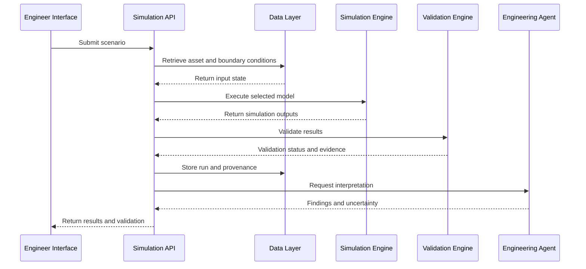

## 7.6 Simulation inputs

A scenario should define:

- Asset identifier.
- Pipeline segment or network.
- Initial pressure.
- Initial temperature.
- Oil flow rate.
- Gas flow rate.
- Water flow rate.
- Solids loading.
- Fluid properties.
- Boundary conditions.
- Geometry.
- Simulation duration.
- Time-step settings.
- Selected model.
- Model version.

## 7.7 Simulation outputs

Potential outputs include:

| Output | Purpose |
|---|---|
| Pressure field | Spatial pressure distribution |
| Temperature field | Thermal distribution |
| Velocity field | Local flow velocity |
| Phase fractions | Phase distribution |
| Liquid holdup | Liquid accumulation indicator |
| Pressure drop | Segment pressure-loss indicator |
| Flow regime | Flow-pattern classification |
| Wall shear | Local wall-interaction indicator |
| Transient history | Time-dependent system behavior |

## 7.8 Model fidelity labels

Every simulation result should carry a model-fidelity label.

| Label | Meaning |
|---|---|
| Demo screening | Synthetic or simplified demonstration calculation |
| Reduced-order | Approximate model with a defined training domain |
| 1D transient | Pipeline-wide one-dimensional model |
| 3D CFD | Local computational fluid-dynamics model |
| Externally validated | Model with documented independent validation evidence |

The label should describe what actually ran, not what the interface visually suggests.

---

# 8. Sensor Fusion and Virtual Instrumentation

## 8.1 Why sensor fusion matters

Subsea pipeline systems cannot be assumed to have a complete sensor network at every location.

Measurements may be sparse, delayed, unavailable, noisy, or inconsistent.

EchoTwin therefore treats sensor data quality as a first-class engineering concern.

The platform separates:

- Direct measurement.
- Processed measurement.
- Estimated measurement.
- Model-derived quantity.
- Missing or unavailable data.

## 8.2 Sensor architecture

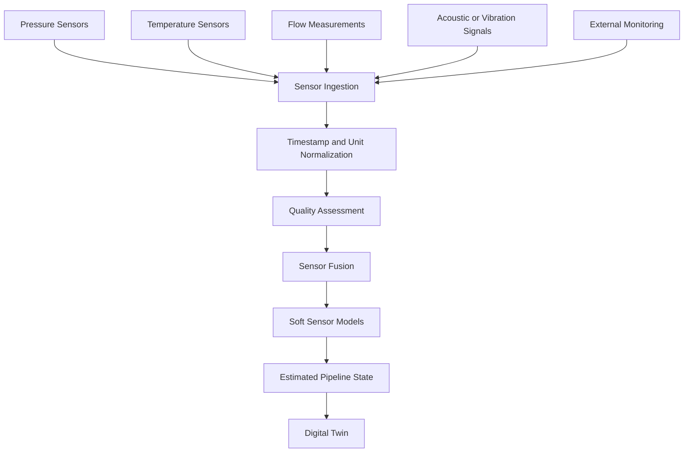

## 8.3 Sensor types

| Sensor category | Example measurement |
|---|---|
| Pressure | Internal pressure |
| Temperature | Fluid or wall temperature |
| Flow | Volumetric or mass flow |
| Acoustic | Sound or pressure-related signatures |
| Vibration | Dynamic mechanical response |
| Structural | Strain or deformation |
| Environmental | External temperature and conditions |

## 8.4 Soft sensors

A soft sensor estimates an otherwise unavailable quantity from available measurements and a model.

For example:

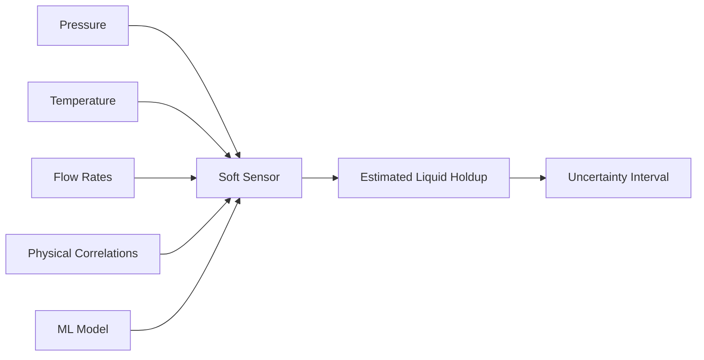

Potential soft sensors include:

- Liquid holdup estimator.
- Gas-fraction estimator.
- Flow-regime estimator.
- Pressure-drop estimator.
- Temperature-field estimator.
- Hydrate-risk estimator.

A soft sensor does not convert an estimate into a direct measurement.

Every estimated value should identify:

1. Its estimation method.
2. Supporting sensor inputs.
3. Model version.
4. Timestamp.
5. Uncertainty.
6. Applicable operating range.

## 8.5 Sensor quality states

Suggested quality states:

| State | Interpretation |
|---|---|
| Valid | Measurement passed configured quality checks |
| Suspect | Measurement may be unreliable |
| Missing | No measurement is available |
| Stale | Measurement is older than the configured threshold |
| Outlier | Measurement requires investigation |
| Estimated | Value was produced by a model |
| Offline | Sensor is not reporting |

## 8.6 Sensor fusion and uncertainty

A general state-estimation representation is:

\[
\hat{\mathbf{x}} =
f(\mathbf{y},\mathbf{m},\mathbf{c})
\]

where:

- \(\mathbf{y}\) represents measurements.
- \(\mathbf{m}\) represents model information.
- \(\mathbf{c}\) represents operating context.
- \(\hat{\mathbf{x}}\) represents the estimated pipeline state.

The uncertainty of the estimate should be represented separately from the estimate itself.

## 8.7 Sensor fault injection

The demo environment can include configurable examples of:

- Pressure drift.
- Temperature bias.
- Missing samples.
- Delayed samples.
- Sudden measurement spikes.
- Frozen sensor values.
- Noisy signals.

These are useful for testing whether the platform identifies degraded data quality.

---

# 9. Flow Assurance Intelligence

## 9.1 Overview

Flow assurance concerns the ability to maintain reliable flow through a production system under changing conditions.

EchoTwin organizes flow-assurance investigations around pipeline location, time, and operating state.

Its initial focus includes:

- Severe slugging.
- Pressure oscillations.
- Flow-regime changes.
- Liquid accumulation.
- Hydrate-favorable conditions.
- Potential deposition.
- Sand transport.
- Localized restrictions.

## 9.2 Flow-assurance workflow

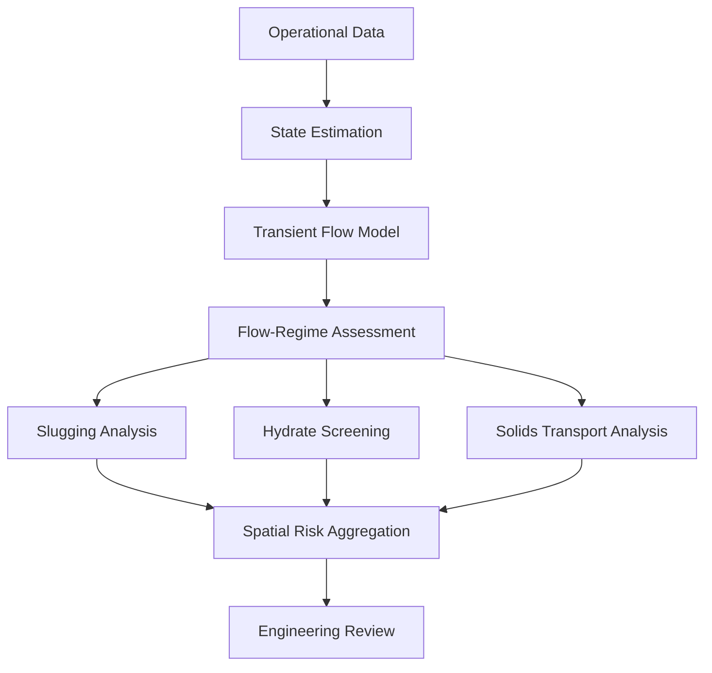

## 9.3 Severe slugging

Severe slugging is an important transient multiphase-flow concern.

The platform can organize investigations around:

- Pressure oscillation amplitude.
- Oscillation frequency.
- Flow-rate variation.
- Liquid accumulation.
- Flow-regime transitions.
- Segment-specific pressure behavior.
- Potentially affected bends and risers.

Example analytical workflow:

1. Select a pipeline asset.
2. Choose an operating interval.
3. Review pressure and flow signals.
4. Identify abnormal oscillatory behavior.
5. Compare the observations with model predictions.
6. Locate the relevant pipeline segments.
7. Review the uncertainty and supporting evidence.

## 9.4 Signal analysis

A simplified signal-analysis workflow may use:

\[
x(t)=\text{measured pressure signal}
\]

Potential features include:

- Mean pressure.
- Standard deviation.
- Peak-to-peak amplitude.
- Frequency-domain energy.
- Dominant frequency.
- Trend and rate of change.

A spectral representation is:

\[
X(f)=\mathcal{F}\{x(t)\}
\]

where \(\mathcal{F}\) denotes the Fourier transform.

Signal features can support anomaly screening, but do not independently establish a particular physical mechanism.

## 9.5 Spatially synchronized slugging analysis

A distinctive EchoTwin capability is the connection between signal-analysis results and the 3D pipeline representation.

If a selected segment exhibits unusual pressure behavior, the interface can highlight that segment and display:

- Relevant measurements.
- Historical signal behavior.
- Simulation outputs.
- Flow-regime estimates.
- Associated engineering investigations.

The highlighted region should represent the evidence location, not an assertion that the exact physical cause has been proven.

---

# 10. Hydrate Formation and Deposition

## 10.1 Why hydrates matter

Gas hydrates are crystalline structures that can form under suitable pressure, temperature, and composition conditions in the presence of water.

In subsea production systems, hydrate-related concerns are important because they can affect flow reliability.

However, hydrate stability and hydrate blockage are not equivalent.

A pipeline may enter hydrate-favorable conditions without immediately developing a damaging restriction.

EchoTwin therefore separates several stages.

## 10.2 Hydrate progression model

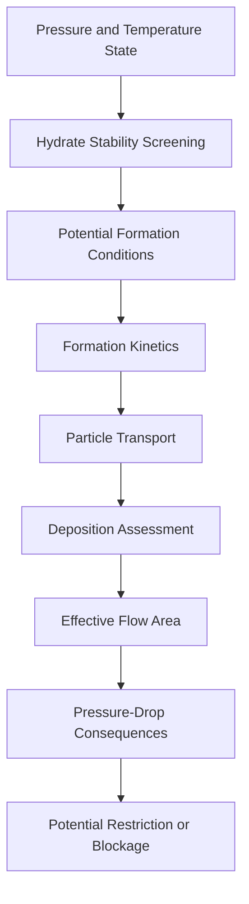

## 10.3 Spatial hydrate representation

For every relevant pipeline segment, a hydrate investigation can maintain:

- Temperature.
- Pressure.
- Hydrate equilibrium conditions.
- Predicted formation indicators.
- Hydrate concentration.
- Deposition thickness.
- Effective flow area.
- Pressure-drop evolution.

The objective is to represent potential hydrate behavior as a spatially evolving engineering field rather than a single unexplained risk percentage.

## 10.4 Hydrate screening versus deposition modeling

| Analysis type | What it evaluates |
|---|---|
| Stability screening | Whether conditions may favor hydrate stability |
| Formation model | Potential formation behavior |
| Kinetic model | Rate-related formation behavior |
| Transport model | Movement of hydrate particles |
| Deposition model | Potential accumulation on internal surfaces |
| Restriction model | Potential effect on available flow area |

These are distinct levels of model complexity.

## 10.5 Example segment result

```json
{
  "asset_id": "ET-001",
  "segment_id": "ET-001-SEG-004",
  "analysis_type": "hydrate_screening",
  "pressure_pa": 12500000,
  "temperature_k": 278.15,
  "result": {
    "status": "requires_review",
    "stability_indicator": "illustrative_favorable_conditions",
    "deposition_model_available": false
  },
  "provenance": {
    "dataset_type": "synthetic",
    "model_version": "demo-screening-1.0"
  }
}
```

This example is not a hydrate equilibrium calculation or a validated deposition prediction. A real assessment requires suitable fluid composition, thermodynamic models, operating conditions, and validation.

## 10.6 Future development

A higher-fidelity hydrate module should consider:

- Composition-dependent hydrate equilibrium.
- Water availability.
- Heat transfer.
- Formation kinetics.
- Particle transport.
- Deposition thickness.
- Effective flow-area changes.
- Coupling to transient multiphase flow.

---

# 11. Sand Transport and Erosion

## 11.1 Engineering motivation

Produced sand can be transported with the fluid phases.

Its movement can depend on:

- Particle size.
- Particle density.
- Solids concentration.
- Fluid velocity.
- Fluid properties.
- Pipe orientation.
- Geometry.
- Local flow conditions.

Sand transport can be relevant to deposition and erosion investigations.

## 11.2 Sand transport architecture

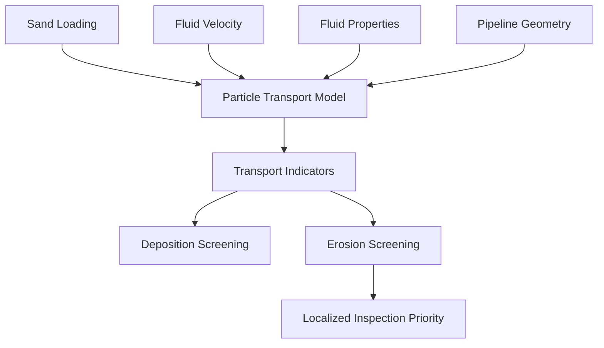

## 11.3 Erosion-related indicators

Potential indicators include:

- Solids concentration.
- Particle velocity.
- Fluid velocity.
- Local flow direction.
- Bend geometry.
- Localized high-velocity regions.
- Estimated wall interaction.

An erosion screening result is not automatically a wall-thickness prediction.

Quantitative erosion assessment requires an appropriate model, material properties, particle characteristics, geometry, and validation evidence.

## 11.4 Localized investigation

The 3D interface can show:

- Bends and elbows.
- Candidate high-velocity areas.
- Sand transport indicators.
- Historical inspection locations.
- Potential inspection priorities.

The system should distinguish a screening result from a quantified material-loss estimate.

---

# 12. Leak Detection and Localization

## 12.1 Leak detection concept

A leak-detection workflow can combine multiple signals and physical-model expectations.

Potential evidence includes:

- Pressure changes.
- Flow imbalance.
- Temperature changes.
- Acoustic anomalies.
- Historical operating patterns.
- Model residuals.
- Spatial relationships between sensors.

No single anomaly should automatically be treated as proof of a leak.

## 12.2 Detection workflow

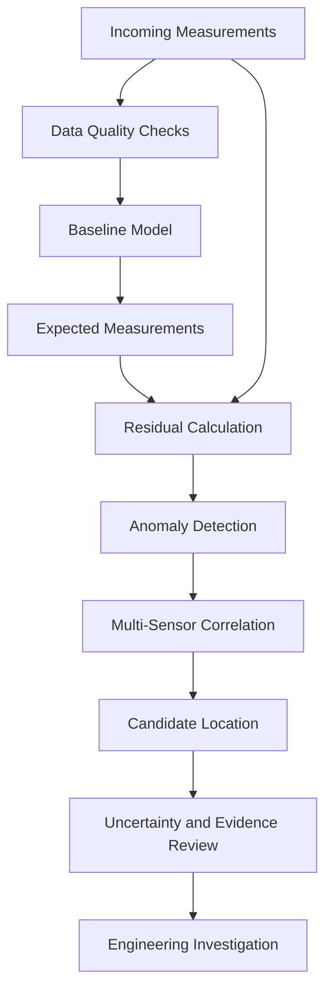

## 12.3 Residual-based screening

A simple residual can be represented as:

\[
r(t)=y_{\text{observed}}(t)-y_{\text{predicted}}(t)
\]

where:

- \(y_{\text{observed}}\) is a measured quantity.
- \(y_{\text{predicted}}\) is the model-predicted quantity.
- \(r(t)\) is the residual.

An unusually large residual can trigger further investigation.

However, residuals may also result from:

- Sensor faults.
- Incorrect boundary conditions.
- Unmodeled operating changes.
- Model limitations.
- Data synchronization errors.

## 12.4 Localization

The platform can rank candidate pipeline segments using:

- Sensor coverage.
- Pressure residual patterns.
- Flow-balance information.
- Model sensitivity.
- Spatial relationships.
- Uncertainty.

A candidate location should be accompanied by supporting evidence and uncertainty rather than presented as an exact leak coordinate without adequate data.

## 12.5 Leak investigation record

A leak investigation should preserve:

```json
{
  "investigation_id": "LEAK-INV-001",
  "asset_id": "ET-001",
  "status": "requires_engineering_review",
  "candidate_segments": [
    {
      "segment_id": "ET-001-SEG-004",
      "evidence": [
        "pressure_residual",
        "flow_imbalance"
      ],
      "confidence": 0.71
    }
  ],
  "dataset_type": "synthetic_demo",
  "automatic_safety_action": false
}
```

The confidence value in this example is illustrative and is not a calibrated probability.

---

# 13. Structural Integrity and Pipeline Health

## 13.1 Connecting fluid and structural behavior

A major EchoTwin objective is to connect internal flow behavior with external pipeline condition.

The structural twin should be associated with the same pipeline segments and spatial coordinate system used by the fluid twin.

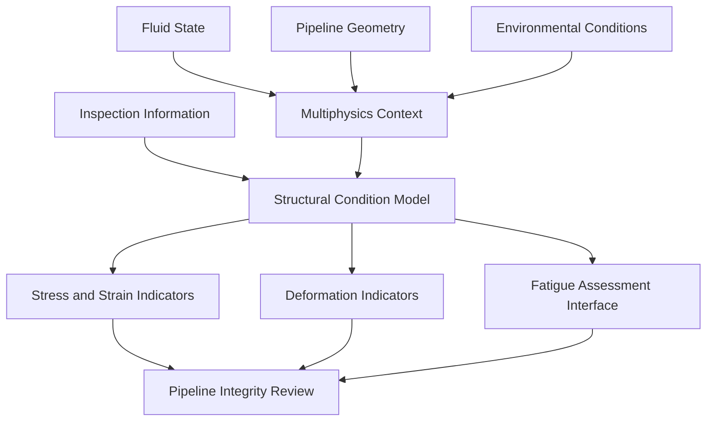

## 13.2 Structural information

Potential structural variables include:

- Wall thickness.
- Material properties.
- Stress.
- Strain.
- Curvature.
- Deformation.
- Support conditions.
- Span length.
- Fatigue history.
- Inspection observations.

## 13.3 Suspended pipeline and seabed interaction

Subsea pipeline integrity can be affected by:

- Unsupported spans.
- Seabed conditions.
- Environmental loading.
- Pipeline curvature.
- Installation geometry.
- Operational changes.

EchoTwin can organize these variables in a spatially indexed asset model.

A higher-fidelity structural analysis may require finite-element analysis or other specialized engineering tools.

## 13.4 Structural damage agent

The Structural Integrity Agent is intended to organize available evidence and identify areas requiring further analysis.

Potential responsibilities:

1. Retrieve pipeline geometry.
2. Retrieve available inspection information.
3. Identify structural monitoring records.
4. Review available stress and deformation indicators.
5. Connect findings with relevant operating conditions.
6. Identify missing information.
7. Produce a traceable investigation summary.

It must not invent missing inspection measurements or claim to have performed an FEA calculation when it has not.

## 13.5 Remaining useful life

Predictive remaining useful life is a research and engineering capability that requires suitable historical degradation data and a validated methodology.

It should not be generated from arbitrary demonstration scores.

A future RUL module should preserve:

- Degradation model.
- Input inspection history.
- Material and loading assumptions.
- Uncertainty distribution.
- Model version.
- Validation results.

---

# 14. AI Engineering Agent Architecture

## 14.1 Why specialized agents?

A general-purpose language model is not a substitute for every engineering subsystem.

EchoTwin uses specialized agent roles to organize engineering investigations.

The numerical model calculates its outputs. The validation engine checks them. The AI agents help coordinate and interpret the evidence.

## 14.2 Agent ecosystem

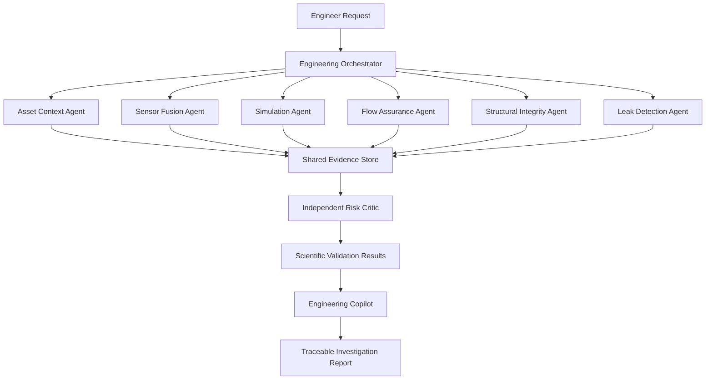

## 14.3 Agent responsibilities

### 1. Engineering Orchestrator

Coordinates the investigation.

Responsibilities:

- Understand the request.
- Identify the relevant asset.
- Determine which subsystems are needed.
- Create investigation tasks.
- Track execution status.
- Collect results.
- Preserve provenance.

### 2. Asset Context Agent

Provides relevant asset information.

Responsibilities:

- Retrieve pipeline metadata.
- Identify relevant segments.
- Retrieve geometry.
- Retrieve operating context.
- Identify missing asset information.

### 3. Sensor Fusion Agent

Reviews measurements and data quality.

Responsibilities:

- Identify missing data.
- Detect stale measurements.
- Flag unusual signals.
- Compare related sensors.
- Request or execute configured soft-sensor estimates.
- Preserve uncertainty.

### 4. Simulation Agent

Coordinates engineering calculations.

Responsibilities:

- Prepare scenario inputs.
- Check required parameters.
- Select an available simulation method.
- Execute the selected engine.
- Store results.
- Request independent validation.

### 5. Flow Assurance Agent

Coordinates flow-assurance investigations.

Responsibilities:

- Review flow conditions.
- Analyze available slugging indicators.
- Retrieve hydrate screening results.
- Review sand transport indicators.
- Identify locations requiring further analysis.

### 6. Structural Integrity Agent

Organizes structural evidence.

Responsibilities:

- Retrieve structural data.
- Identify relevant pipeline geometry.
- Review inspection information.
- Identify unsupported assumptions.
- Produce engineering-review summaries.

### 7. Leak Detection Agent

Coordinates anomaly investigations.

Responsibilities:

- Review sensor residuals.
- Correlate available signals.
- Rank candidate segments.
- Record uncertainty.
- Recommend further investigation.

### 8. Risk Critic

Independently reviews proposed findings.

Responsibilities:

- Identify unsupported conclusions.
- Check model provenance.
- Identify missing evidence.
- Review validation status.
- Flag conflicting results.
- Reject claims that exceed available evidence.

### 9. Engineering Copilot

Provides a natural-language interface to the platform.

Responsibilities:

- Explain simulation results.
- Summarize sensor behavior.
- Describe model limitations.
- Explain risk indicators.
- Prepare report drafts.
- Identify further information needed.

## 14.4 Agent execution contract

Every agent task should have a defined input and output.

Example:

```json
{
  "task_id": "TASK-001",
  "agent": "flow_assurance_agent",
  "asset_id": "ET-001",
  "scope": {
    "segment_ids": [
      "ET-001-SEG-003",
      "ET-001-SEG-004"
    ]
  },
  "inputs": {
    "simulation_run_id": "SIM-001",
    "sensor_window": "2026-11-18T10:00:00Z/2026-11-18T11:00:00Z"
  },
  "output": {
    "status": "completed",
    "findings": [],
    "limitations": [],
    "evidence_references": []
  }
}
```

## 14.5 Agent safety boundaries

AI agents must not:

- Change raw measurements.
- Invent sensor readings.
- Override failed validation checks.
- Claim a CFD solver ran when it did not.
- Present synthetic data as live telemetry.
- Authorize operational set-point changes.
- Trigger safety-critical actions.
- Present a screening score as a certified risk assessment.

The AI layer is an orchestration and explanation layer, not the authority for physical safety decisions.

---

# 15. Scientific Verification and Validation

## 15.1 Why validation is a core feature

A technically impressive visualization is not sufficient evidence that an engineering prediction is trustworthy.

EchoTwin therefore separates result generation from scientific assessment.

The validation subsystem evaluates whether the inputs and outputs satisfy defined checks.

The AI layer can explain validation findings but cannot override them.

## 15.2 Scientific validation architecture

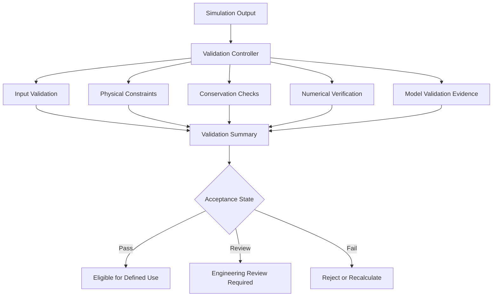

## 15.3 Validation categories

### A. Input validation

Check:

- Required values exist.
- Units are recognized.
- Values are within configured ranges.
- Boundary conditions are complete.
- Geometry is available.
- Phase fractions are admissible.
- Time-step settings are valid.

### B. Physical constraints

Check relevant physical requirements, including:

\[
p_{\text{absolute}}>0
\]

and valid phase fractions.

Additional checks should be specific to the model and its assumptions.

### C. Conservation checks

Potential checks include:

- Mass conservation.
- Momentum consistency.
- Energy balance.

### D. Numerical verification

Potential checks include:

- Solver convergence.
- Grid convergence.
- Time-step sensitivity.
- Numerical stability.
- Residual behavior.

### E. Model validation

Potential evidence includes:

- Experimental comparison.
- Reference-solver comparison.
- Field-data comparison.
- Prediction error.
- Uncertainty quantification.

Verification and validation are different activities.

Verification asks whether the numerical implementation solves its intended mathematical problem correctly.

Validation asks whether the mathematical model adequately represents the physical system for its intended use.

## 15.4 Validation states

| State | Meaning |
|---|---|
| Not evaluated | No validation has been performed |
| Passed | Defined checks passed |
| Warning | Some checks require review |
| Failed | One or more required checks failed |
| Incomplete | Evidence is insufficient |
| Not applicable | Check does not apply to the selected model |

## 15.5 Scientific contract

Each simulation should preserve:

```json
{
  "validation_id": "VAL-001",
  "simulation_run_id": "SIM-001",
  "checks": {
    "input_validation": "passed",
    "physical_constraints": "passed",
    "mass_conservation": "not_evaluated",
    "grid_convergence": "not_applicable",
    "experimental_validation": "not_evaluated"
  },
  "overall_status": "incomplete",
  "model_fidelity": "demo_screening",
  "review_required": true
}
```

A demo screening model must not be assigned a full CFD validation status simply because its input checks passed.

---

# 16. 3D Visualization and Engineering Interface

## 16.1 Interface objective

The 3D pipeline is the spatial anchor of the application.

It should allow engineers to move between the physical representation and the data associated with each location.

The interface connects:

- Pipeline geometry.
- Segment selection.
- Sensor locations.
- Pressure and temperature.
- Flow behavior.
- Simulation outputs.
- Risk overlays.
- Structural indicators.
- Historical events.

## 16.2 Main interface concept

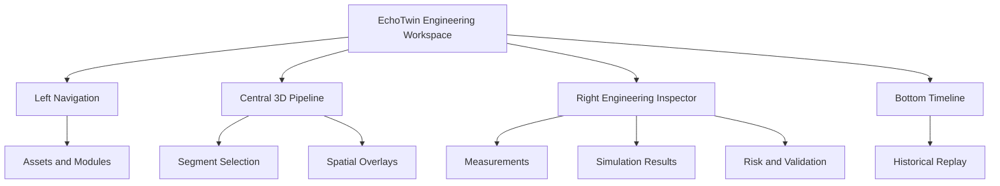

## 16.3 Suggested interface modules

### Engineering dashboard

Displays:

- Asset status.
- Active investigations.
- Sensor health.
- Recent simulation runs.
- Current screening indicators.
- Outstanding validation reviews.

### 3D pipeline viewer

Provides:

- Orbit and zoom.
- Segment selection.
- Pipeline route visualization.
- Sensor markers.
- Flow direction.
- Color-coded overlays.
- Spatial inspection.

### Sensor explorer

Provides:

- Measurement history.
- Time-series charts.
- Sensor-quality states.
- Anomaly markers.
- Measured-versus-estimated comparison.

### Simulation workspace

Provides:

- Scenario configuration.
- Model selection.
- Input review.
- Execution status.
- Output charts.
- Validation evidence.

### Flow-assurance workspace

Provides:

- Slugging indicators.
- Hydrate screening.
- Solids transport indicators.
- Segment-level investigations.

### Integrity workspace

Provides:

- Structural information.
- Inspection records.
- Localized condition indicators.
- Engineering-review status.

### Report center

Provides:

- Investigation summaries.
- Simulation details.
- Model provenance.
- Validation results.
- Exportable reports.

## 16.4 Spatial selection behavior

When a user selects a pipeline segment, the application should synchronize all related views.

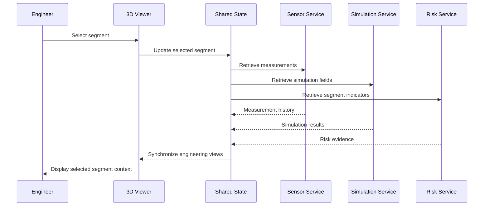

## 16.5 Visual design principles

The interface should prioritize:

- Clear hierarchy.
- High contrast.
- Consistent engineering units.
- Legible data labels.
- Responsive layout.
- Meaningful status indicators.
- Consistent color semantics.
- Explicit distinction between measured and estimated values.

Color should not be the only way to communicate a status. Include text labels and accessible contrast.

---

# 17. Backend, APIs, and Data Infrastructure

## 17.1 Backend responsibilities

The backend coordinates:

- Asset retrieval.
- Sensor ingestion.
- Data normalization.
- Scenario creation.
- Simulation execution.
- Validation.
- Agent orchestration.
- Report generation.
- Audit history.

A modular API structure keeps engineering services independent from the frontend.

## 17.2 Example API map

| Method | Endpoint | Purpose |
|---|---|---|
| GET | `/api/assets` | List pipeline assets |
| GET | `/api/assets/{asset_id}` | Retrieve an asset |
| GET | `/api/assets/{asset_id}/segments` | Retrieve segments |
| GET | `/api/assets/{asset_id}/sensors` | Retrieve sensors |
| GET | `/api/sensors/{sensor_id}/readings` | Retrieve readings |
| GET | `/api/assets/{asset_id}/state` | Retrieve current twin state |
| POST | `/api/scenarios` | Create a scenario |
| GET | `/api/scenarios/{scenario_id}` | Retrieve a scenario |
| POST | `/api/simulations` | Submit a simulation |
| GET | `/api/simulations/{run_id}` | Retrieve a simulation run |
| GET | `/api/simulations/{run_id}/results` | Retrieve outputs |
| GET | `/api/simulations/{run_id}/validation` | Retrieve validation |
| POST | `/api/agents/investigate` | Start an agent investigation |
| GET | `/api/agents/{run_id}` | Retrieve agent execution |
| GET | `/api/risks` | Retrieve risk assessments |
| POST | `/api/reports` | Generate a report |

These are the logical API contracts for the platform. Route names should be aligned with the actual implementation.

## 17.3 Example simulation request

```json
{
  "asset_id": "ET-001",
  "scenario_name": "Transient Flow Investigation",
  "model": {
    "type": "transient_1d",
    "version": "demo-1.0"
  },
  "time": {
    "duration_seconds": 600,
    "time_step_seconds": 1
  },
  "operating_conditions": {
    "pressure_pa": 12500000,
    "temperature_k": 278.15,
    "oil_flow_rate_m3_s": 0.025,
    "gas_flow_rate_m3_s": 0.08,
    "water_flow_rate_m3_s": 0.01,
    "sand_mass_rate_kg_s": 0.001
  },
  "metadata": {
    "dataset_type": "synthetic",
    "purpose": "demonstration"
  }
}
```

## 17.4 Example simulation response

```json
{
  "run_id": "SIM-001",
  "status": "completed",
  "asset_id": "ET-001",
  "model_fidelity": "demo_screening",
  "outputs": {
    "pressure_field": [],
    "temperature_field": [],
    "phase_fractions": [],
    "flow_regime": "intermittent"
  },
  "validation": {
    "status": "incomplete",
    "review_required": true
  },
  "provenance": {
    "dataset_type": "synthetic",
    "model_version": "demo-1.0"
  }
}
```

## 17.5 Asynchronous simulation execution

Long-running calculations should not block the main application request.

```mermaid
flowchart LR
    A["Frontend"] --> B["API"]
    B --> C["Create Simulation Job"]
    C --> D["Job Queue"]
    D --> E["Simulation Worker"]
    E --> F["Validation Worker"]
    F --> G["Result Store"]
    G --> H["Status API"]
    H --> A
```

The architecture can support background workers as model complexity grows.

## 17.6 Data storage strategy

Different data types have different storage requirements.

| Data | Suitable storage pattern |
|---|---|
| Asset metadata | Relational or document database |
| Sensor time series | Time-series database or optimized time-series tables |
| Geometry | Spatial database or structured geometry store |
| Simulation configuration | Versioned structured records |
| Simulation outputs | Structured arrays and object storage |
| Reports | Document or object storage |
| Audit records | Append-oriented audit store |
| Agent traces | Structured event records |

The specific database should be selected according to deployment requirements, data volume, query patterns, and operational constraints.

## 17.7 Data provenance

A simulation record should identify:

- Input dataset.
- Asset version.
- Geometry version.
- Boundary conditions.
- Fluid-property source.
- Model name.
- Model version.
- Numerical settings.
- Execution timestamp.
- Validation results.
- Output location.

This enables an engineer to understand how a result was produced.

---

# 18. Demo Data, Scenarios, and Reproducibility

## 18.1 Demonstration environment

EchoTwin includes a synthetic demonstration-data architecture designed to make the platform explorable without connecting to live subsea equipment.

The demo dataset should be visibly labeled as synthetic.

It should never be represented as real offshore telemetry.

## 18.2 Demonstration assets

An example asset catalog:

| Asset | Description | Intended demonstration |
|---|---|---|
| ET-001 | North Atlantic Production Pipeline | Main multiphase pipeline |
| ET-002 | Deepwater Riser System | Transient and riser behavior |
| ET-003 | Subsea Export Line | Flow assurance |
| ET-004 | Sand-Producing Test Line | Solids transport and erosion screening |

These names are fictional demonstration identifiers.

## 18.3 Example demo dataset scale

A configurable seed dataset may contain:

| Dataset | Example records |
|---|---:|
| Pipeline assets | 4 |
| Pipeline segments | 40 |
| Sensors | 32 |
| Sensor readings | 2,000 |
| Spatial samples | 500 |
| Engineering scenarios | 20 |
| Simulation runs | 30 |

These are demonstration targets, not claims about live infrastructure or field measurements.

## 18.4 Demo scenario catalog

| Scenario | Objective |
|---|---|
| Normal operation | Establish a baseline |
| Increased gas flow | Examine changing phase behavior |
| Reduced liquid flow | Investigate altered liquid transport |
| Pressure disturbance | Explore transient response |
| Temperature reduction | Demonstrate hydrate screening |
| Increased water fraction | Explore fluid-composition changes |
| Increased sand loading | Demonstrate solids transport indicators |
| Pressure oscillation | Explore slugging-related signals |
| Sensor drift | Test measurement-quality handling |
| Missing sensor | Test incomplete data handling |
| Sudden flow change | Explore transient behavior |
| Shutdown | Demonstrate operating-state transition |
| Restart | Explore a restart scenario |
| Localized restriction | Demonstrate pressure-drop investigation |
| Potential leak | Explore anomaly detection |
| Riser investigation | Inspect a localized geometry |
| Structural review | Demonstrate integrity workflows |
| Multi-sensor anomaly | Test evidence correlation |
| Scenario comparison | Compare two configurations |
| Full engineering review | Demonstrate end-to-end workflow |

## 18.5 Deterministic data generation

Reproducibility is important.

A deterministic generator should use a controlled seed.

```python
import random

def generate_demo_readings(seed: int, count: int):
    rng = random.Random(seed)

    readings = []

    for index in range(count):
        readings.append({
            "reading_id": f"READ-{index + 1:06d}",
            "pressure_pa": round(
                rng.uniform(9_000_000, 15_000_000),
                2
            ),
            "temperature_k": round(
                rng.uniform(275, 295),
                2
            ),
            "quality": "valid"
        })

    return readings
```

This example demonstrates deterministic generation only. It is not a physical pipeline simulator.

## 18.6 Reproducible simulation runs

Every run should store:

```text
Simulation Run
│
├── Run ID
├── Asset ID
├── Scenario ID
├── Dataset Version
├── Random Seed
├── Model Name
├── Model Version
├── Input Parameters
├── Boundary Conditions
├── Numerical Configuration
├── Execution Timestamp
├── Output References
├── Validation Results
└── Agent Analysis References
```

## 18.7 Scenario comparison

The comparison interface should support:

- Baseline versus changed conditions.
- Pressure history.
- Temperature history.
- Phase-fraction history.
- Segment-level indicators.
- Model fidelity.
- Validation status.
- Input differences.

A comparison should make it clear whether differences arise from changed physical inputs, changed model versions, or changed data.

## 18.8 Example end-to-end demonstration

**Scenario: Investigating a pressure anomaly near a pipeline bend**

1. Open asset ET-001.
2. Inspect the pipeline geometry.
3. Select segment ET-001-SEG-004.
4. Open the sensor explorer.
5. Review the pressure history.
6. Identify the interval containing an unusual signal.
7. Review sensor-quality indicators.
8. Create a transient investigation scenario.
9. Run the configured demonstration model.
10. Review the model-fidelity label.
11. Inspect validation checks.
12. Open the Flow Assurance Agent's findings.
13. Compare the result with the baseline.
14. Review the spatial overlay.
15. Generate an investigation report.

The walkthrough demonstrates the software workflow. It does not establish that the anomaly is caused by a particular physical mechanism.

---

# 19. Installation, Testing, and Deployment

## 19.1 Technology architecture

The reference application architecture uses a web-based frontend, API backend, visualization layer, and independent engineering modules.

A suggested technology mapping:

| Layer | Reference technology |
|---|---|
| Frontend | React |
| Language | TypeScript |
| Build tooling | Vite |
| 3D visualization | Three.js / React Three Fiber |
| Backend | Python / FastAPI |
| API format | REST / JSON |
| Physics modules | Python numerical packages |
| Data validation | Typed schemas and validation services |
| AI orchestration | Modular agent interfaces |
| Testing | Unit, integration, and end-to-end tests |

The actual repository's package manifests and source files should be treated as authoritative for exact versions and dependencies.

## 19.2 Prerequisites

Install:

- Node.js and npm.
- Python 3.10 or a compatible supported version.
- Git.
- A code editor.
- Optional Docker for containerized development.

## 19.3 Clone the repository

```bash
git clone https://github.com/YOUR_USERNAME/echotwin-ai.git

cd echotwin-ai
```

Replace `YOUR_USERNAME` with the actual GitHub account or organization.

## 19.4 Frontend installation

```bash
cd frontend

npm install

npm run dev
```

Open the local address printed by the development server.

## 19.5 Backend installation

In a separate terminal:

```bash
cd backend

python -m venv .venv
```

Activate the environment.

macOS/Linux:

```bash
source .venv/bin/activate
```

Windows:

```powershell
.venv\Scripts\activate
```

Install dependencies:

```bash
pip install -r requirements.txt
```

Start the API:

```bash
uvicorn app.main:app --reload
```

The example assumes the backend entry point is `app.main:app`. Adjust it if the repository uses a different module path.

## 19.6 Environment variables

Create a local environment file based on `.env.example`.

Example:

```env
APP_ENV=development

API_HOST=127.0.0.1
API_PORT=8000

DEMO_MODE=true
DEMO_DATASET=echotwin-demo-v1
DEMO_RANDOM_SEED=42

DATABASE_URL=

AI_PROVIDER=
AI_MODEL=

LOG_LEVEL=INFO
```

Do not commit production secrets, credentials, or private API keys.

## 19.7 Docker deployment concept

```mermaid
flowchart TB
    A["User Browser"] --> B["Frontend Container"]
    B --> C["Backend API Container"]
    C --> D["Engineering Worker"]
    C --> E["Database"]
    D --> E
    C --> F["Object Storage"]
    D --> F
```

A containerized deployment can isolate:

- Frontend.
- API.
- Background workers.
- Database.
- Object storage.

The exact service definitions should be maintained in the repository's Docker configuration.

## 19.8 Testing strategy

A complete engineering application needs more than interface tests.

### Frontend tests

Test:

- Dashboard rendering.
- Asset selection.
- Segment selection.
- Chart interactions.
- Scenario forms.
- Simulation status.
- Validation displays.
- Report generation.

### Backend tests

Test:

- API response schemas.
- Asset retrieval.
- Sensor queries.
- Scenario creation.
- Simulation execution.
- Result persistence.
- Agent execution.
- Report generation.

### Physics tests

Test:

- Phase-fraction constraints.
- Unit consistency.
- Boundary-condition handling.
- Conservation behavior where implemented.
- Numerical stability.
- Solver convergence.
- Sensitivity to time-step changes.

### Integration tests

Test:

- Sensor data to digital twin.
- Digital twin to simulation.
- Simulation to validation.
- Validation to risk assessment.
- Agent output to engineering report.

### End-to-end tests

Test a complete investigation from asset selection through report generation.

## 19.9 Example test commands

Frontend:

```bash
npm run test
```

Backend:

```bash
pytest
```

Static checks:

```bash
npm run lint
```

Use the commands actually defined in the repository's package and project configuration.

## 19.10 Production-readiness checklist

- [ ] Authentication and authorization.
- [ ] Role-based access control.
- [ ] Secure secrets management.
- [ ] API input validation.
- [ ] Audit logging.
- [ ] Backup and recovery.
- [ ] Database migrations.
- [ ] Data retention policies.
- [ ] Monitoring and alerting.
- [ ] Simulation resource limits.
- [ ] Model versioning.
- [ ] Scientific validation evidence.
- [ ] Performance testing.
- [ ] Security testing.
- [ ] Operational approval process.

A successful local demonstration does not automatically mean that the platform is ready for operational deployment.

---

# 20. Roadmap, Research Opportunities, and Conclusion

## 20.1 Development roadmap

The following roadmap describes logical product-development priorities, not verified delivery dates.

### Phase 1 — Unified asset digital twin

Focus:

- Asset registry.
- Pipeline geometry.
- Segment model.
- Sensor registry.
- Shared spatial coordinate system.
- Historical measurements.
- Interactive 3D viewer.

### Phase 2 — Multiphase transient simulation

Focus:

- Pipeline-wide transient model.
- Pressure and temperature evolution.
- Phase fractions.
- Flow-regime assessment.
- Scenario management.
- Numerical configuration.
- Validation framework.

### Phase 3 — Flow assurance

Focus:

- Severe slugging analysis.
- Pressure-signal processing.
- Hydrate stability screening.
- Deposition-model interfaces.
- Sand transport.
- Erosion screening.

### Phase 4 — Hybrid AI and scientific computing

Focus:

- Sensor fusion.
- Soft sensors.
- Reduced-order models.
- Fourier Neural Operators.
- Model uncertainty.
- Simulation acceleration.
- Applicability-domain checks.

### Phase 5 — Structural integrity

Focus:

- Structural asset information.
- Inspection data.
- Structural monitoring.
- FEA integration.
- Deformation analysis.
- Fatigue assessment.

### Phase 6 — Agentic engineering

Focus:

- Specialized agents.
- Investigation orchestration.
- Evidence retrieval.
- Risk critic.
- Engineering copilot.
- Traceable reports.
- Human approval workflows.

## 20.2 Research opportunities

EchoTwin creates opportunities to investigate several technical research questions.

| Research area | Potential contribution |
|---|---|
| Multiphysics integration | Connect internal fluid behavior with external structural condition |
| Hybrid simulation | Combine numerical solvers, reduced-order models, and neural operators |
| Sensor fusion | Estimate unmeasured quantities with uncertainty |
| Slugging analysis | Synchronize signal processing with spatial simulation |
| Hydrate modeling | Connect thermodynamic stability, formation, and deposition |
| Structural monitoring | Link inspection and monitoring information to pipeline geometry |
| Agentic engineering | Coordinate specialized models and engineering investigations |
| Scientific trust | Make predictions traceable to inputs, models, and validation evidence |
| Network prediction | Explore graph-based representations of connected pipeline systems |
| Predictive maintenance | Investigate degradation and remaining useful life with validated data |

## 20.3 Four potential research contributions

**1. Multiphysics integration**

Connect the internal fluid state with structural condition and environmental loading.

**2. Hybrid simulation**

Combine pipeline-wide physical models, localized CFD, and suitable reduced-order approximations.

**3. Agentic engineering**

Use specialized AI agents to coordinate investigations without replacing numerical models or engineering judgment.

**4. Scientific trust**

Make every prediction traceable to input data, model version, validation status, and uncertainty.

## 20.4 Future advanced architecture

```mermaid
flowchart TB
    A["Physical Pipeline and Environment"] --> B["Operational and Inspection Data"]
    B --> C["Unified Asset Digital Twin"]

    C --> D["1D Transient Solver"]
    C --> E["Local 3D CFD"]
    C --> F["Sensor Fusion"]
    C --> G["Structural Model"]

    D --> H["Hybrid Simulation Layer"]
    E --> H
    F --> H
    G --> H

    H --> I["Reduced-Order Models"]
    I --> J["Agentic Engineering Orchestration"]

    D --> K["Scientific Validation"]
    E --> K
    F --> K
    G --> K
    I --> K
    K --> J

    J --> L["Spatial Risk Assessment"]
    L --> M["Human Engineering Review"]
    M --> N["Traceable Engineering Report"]
```

## 20.5 Key performance indicators

The platform should be evaluated using measurable engineering and software criteria.

### Software performance

- API response time.
- Frontend rendering performance.
- 3D interaction responsiveness.
- Simulation job completion time.
- Dataset loading time.
- Report generation time.

### Data quality

- Missing measurement rate.
- Stale measurement rate.
- Sensor-quality classification accuracy.
- Timestamp consistency.
- Unit-normalization correctness.

### Model quality

- Numerical convergence.
- Conservation error.
- Prediction error.
- Calibration quality.
- Uncertainty coverage.
- Applicability-domain performance.

### Engineering workflow

- Time required to investigate a scenario.
- Number of manual data-reconciliation steps.
- Percentage of runs with complete provenance.
- Percentage of results with validation evidence.
- Number of findings requiring additional engineering review.

These metrics should be measured using documented test procedures and representative datasets.

## 20.6 Long-term vision

The long-term vision is to create a unified subsea engineering environment in which an engineer can:

1. Select a physical location on a 3D pipeline.
2. Review historical measurements at that location.
3. Understand the surrounding geometry and operating conditions.
4. Run a transient multiphase simulation.
5. Investigate potential slugging or hydrate behavior.
6. Examine solids transport and erosion indicators.
7. Connect fluid behavior with structural information.
8. Review independent scientific validation.
9. Use AI agents to organize the investigation.
10. Generate a traceable engineering report.

The most important differentiator is not the number of AI agents or visual effects.

It is the ability to demonstrate a complete chain of engineering evidence.

```mermaid
flowchart LR
    A["Engineer Request"] --> B["Physical and Asset Context"]
    B --> C["Validated Inputs"]
    C --> D["Numerical Simulation"]
    D --> E["Independent Scientific Checks"]
    E --> F["AI-Assisted Interpretation"]
    F --> G["Spatially Localized Findings"]
    G --> H["Human Engineering Review"]
    H --> I["Documented Engineering Output"]
```

## 20.7 Final project statement

**EchoTwin AI is a unified subsea multiphase-flow digital-twin platform designed to connect pipeline geometry, operational measurements, physics-based simulation, sensor fusion, flow assurance, structural integrity, and AI-assisted engineering into one spatially synchronized environment.**

Its architecture combines established engineering concepts with emerging opportunities in hybrid simulation, neural operators, soft sensors, and agentic engineering.

The platform's central principle is scientific traceability: engineering findings should be connected to the measurements, assumptions, models, validation evidence, and uncertainty that produced them.

---

# Engineering Disclaimer

EchoTwin AI is a software and research platform. Demonstration datasets, synthetic telemetry, example scenarios, simplified screening calculations, and AI-generated explanations are not substitutes for validated engineering analysis.

Unless explicitly documented otherwise, displayed values should be treated as synthetic or illustrative.

The platform must not be used as the sole basis for:

- Offshore operating decisions.
- Pipeline safety decisions.
- Pressure-limit authorization.
- Emergency response.
- Leak-response actions.
- Hydrate-remediation procedures.
- Structural fitness-for-service determinations.
- Regulatory compliance certification.

Production use requires appropriate physical-model implementation, numerical verification, experimental or field validation, cybersecurity review, engineering governance, and qualified human oversight.

# Contributing

Contributions are welcome from developers, researchers, simulation engineers, data scientists, and subsea engineering specialists.

Suggested contribution areas:

- Multiphase modeling.
- Numerical methods.
- Sensor fusion.
- Signal processing.
- Reduced-order modeling.
- 3D engineering visualization.
- Pipeline integrity.
- AI orchestration.
- Scientific verification.
- Testing and documentation.

Before submitting a contribution:

1. Explain the engineering problem being addressed.
2. Identify assumptions and model limitations.
3. Document input and output units.
4. Include appropriate tests.
5. Document the model or algorithm version.
6. Explain how results are validated.
7. Identify whether the feature uses synthetic or measured data.

# Acknowledgements and Research Foundations

EchoTwin draws on the broader research fields of:

- Subsea pipeline digital twins.
- Multiphase computational fluid dynamics.
- Transient pipeline simulation.
- Flow assurance.
- Gas hydrate thermodynamics and deposition.
- Sensor fusion and virtual instrumentation.
- Structural health monitoring.
- Finite-element analysis.
- Reduced-order modeling.
- Fourier Neural Operators.
- Physics-informed machine learning.
- Multi-agent engineering systems.
- Scientific verification and validation.

Relevant foundational research directions include digital twins for subsea pipelines, pipeline condition monitoring, hybrid physics-based and data-driven models, multiphase measurement and soft sensors, hydrate formation and deposition, and engineering-aware multi-agent systems.

# Project Summary

| Attribute | Description |
|---|---|
| Project | EchoTwin AI |
| Category | Engineering Digital Twin |
| Industry | Subsea / Oil and Gas |
| Core discipline | Multiphase Flow Engineering |
| Physics | Navier–Stokes and conservation-law modeling |
| Fluid system | Oil, gas, water, and sand |
| Visualization | Interactive 3D pipeline environment |
| Intelligence | Sensor fusion and specialized AI agents |
| Flow assurance | Slugging, hydrate, and solids transport |
| Integrity | Structural monitoring and engineering review |
| Trust architecture | Independent verification and validation |
| Primary output | Spatially localized, traceable engineering investigations |

---

<p align="center">

**ECHOTWIN AI**

*Connecting the Physics, the Pipeline, and the Intelligence.*

**One Pipeline. One Digital Twin. A Complete Engineering Picture.**

</p>
